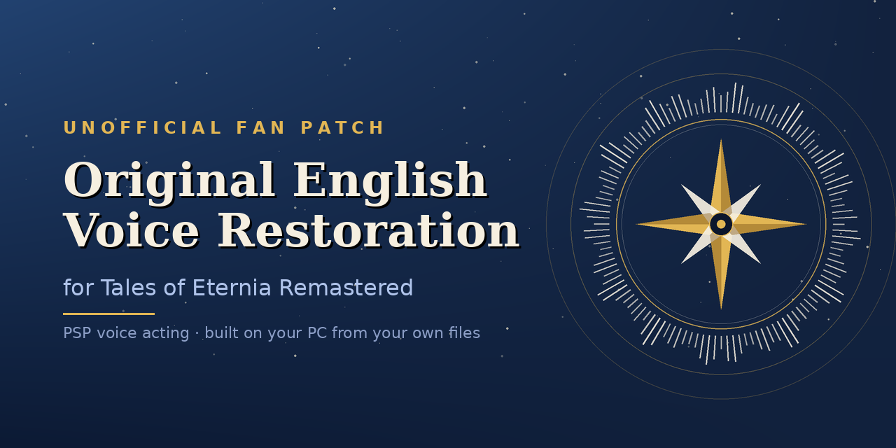

# Tales of Eternia Remastered – Restored English Voices

Puts the original **PSP English voice acting** back into *Tales of Eternia Remastered* (Steam).
The patcher builds everything on **your PC**, from **your own** Steam game and **your own** European PSP disc image –
no game, PSP, audio, video or image file is distributed here.

*Tales of Eternia is known in the US PS1 release as Tales of Destiny II. The voices restored here come from the PSP version.*

**Current version:** 0.9.0 – see [Releases](https://github.com/Old4444/toe-remastered-restored-voices/releases) and [STATUS.md](https://github.com/Old4444/toe-remastered-restored-voices/blob/main/STATUS.md) for what is confirmed and what still needs testers.

## About this release

Version 0.9.0 is the first stable release of this project, but it is **not** meant to be a definitive or 100% accurate restoration.
The project is partly driven by childhood memories of the original game. Extensive research, file analysis and in-game testing went into it,
but some details may still be inaccurate or incomplete: there may be voice lines, mappings or other original-version details that have not been identified or verified yet.
The goal is to get as close as possible to the original English voice experience, and to improve the restoration as much as I can with the time and resources available.

## What it restores

- **All story events:** 1,346 voice lines in 36 event groups.
- **All camp skits:** 79 skits (H001–H079).
- **All battle and minigame voices** in the game's voice bank (`Vo.acb`): 902 cues – 869 with the PSP voice and 33 deliberately muted (no matching line, or silent on the PSP) – plus the **36 hit/damage voices** of the sound-effect bank (S00). Summons included.
- In total, **more than 2,300 voice lines** replaced.
- **Cutscene movies 01 (English), 15 and 24**: the sound is replaced with the PSP sound (the video is untouched).
- **The original opening video**, rebuilt from the opening already in your game plus the PSP audio.
- **Setting: mute the skits that exist only in the remaster.** These skits have no English PSP voice. The installer asks about it and the answer is **yes by default**; you can choose *no* to keep the remaster voice in them. *Side effect of muting:* in those skits the characters' mouths stay closed and some expressions may look odd.

The patcher also **alters the game's title logo** (it shows the patch's name and version); this is not part of the voice restoration.

It does **not** change the game's text or translation. The remaster corrected typos and changed some expressions in the text
([Nintendo Life](https://www.nintendolife.com/news/2026/07/bandai-namco-reveals-changes-and-improvements-in-tales-of-eternia-remastered)),
so a restored line can differ slightly from the subtitle on screen.

## Preview

[Video: the restored opening and a battle (YouTube)](https://youtu.be/mdY7Q3VYdJI)

## Install

1. **Download `ToePatcher.exe`** from the [latest Release](https://github.com/Old4444/toe-remastered-restored-voices/releases/latest): open it and click `ToePatcher.exe` in the **Assets** list at the bottom (not "Source code"). Put it in **its own folder** (about 1 GB of temporary space is used).
2. *(Only for option 1)* Download an LGPL build of **ffmpeg** for Windows – for example `ffmpeg-n9.0-latest-win64-lgpl-9.0.zip` from
   [BtbN/FFmpeg-Builds](https://github.com/BtbN/FFmpeg-Builds/releases/latest) (choose `win64`, **not** `winarm64`). **You only need one file:** extract the zip, take `bin\ffmpeg.exe` and put that `ffmpeg.exe` **right next to `ToePatcher.exe`** (the other files in the zip are not needed). If you prefer, leave it anywhere and select it when the patcher asks. ffmpeg is **not included** in this download.
3. Run `ToePatcher.exe` and choose:
   - **1 – INSTALL, complete:** voices + title logo + cutscene movies + original opening. Needs ffmpeg and takes about **2 to 8 minutes**, depending on your PC.
   - **2 – INSTALL, without videos:** voices + title logo only. No ffmpeg needed.
4. A window asks for your PSP `.iso` / `.cso` (European release, ULES-00176). The patcher checks it, extracts the voices, encodes them and installs. **Backups of the original files are made first.**
5. Start the game.

If the game folder is not found automatically, a window asks you to select it.
To undo everything: run the patcher again and choose **3 – RESTORE**. Steam's *Verify integrity of game files* also reverts the game.

**How the opening and the movies work:** nothing is downloaded. The patcher reads the videos that are **already in your Steam game**, cuts and reorders the opening following a list of cut points ([`edl_final.json`](edl_final.json), included in this repository), puts the PSP audio from **your disc** on it and writes it back in the game's format. It needs the **original** files from Steam: if another mod replaced them, run *Verify integrity of game files* first.

## Requirements

- Windows and the Steam game *Tales of Eternia Remastered* (unmodified – use *Verify integrity* first). Tested up to game version **2.1.0**.
- Your own dump of the **European PSP release (ULES-00176)**. Please do not ask for, or post, links to dumps here.
- `ffmpeg` only for the complete install (option 1). Nothing else needs to be installed. (`VGAudioCli`, included, may need .NET Framework 4.5.1+ – *inference, not verified on every PC*.)

## Game version notice

Most of the work was tested on game version **2.0.0**. The game updated to **2.1.0** (2026-11-02):

- On a clean 2.1.0 install, the original `Vo.acb`, `Vo.awb` and `toe_psp_se_bank_S00.acb` are byte-identical to the 2.0.0 ones (SHA-256 compared), so the voice part should not be affected.
- The title-logo files were renamed and changed by the update; the logo step was adapted for 2.1.0.

If you notice anything different after the update, you can open an Issue. Reports may help inform future updates.

## Notice about AI

AI assistance was used in the development of this project. AI tools (Claude by Anthropic and ChatGPT by OpenAI) helped with code, build tools, research, troubleshooting and documentation.
The project was created by its author, who is not a professional programmer. Its development is validated primarily through practical testing, including file integrity checks, in-game verification and installation/restore tests.
The full source code is in this repository for anyone who wants to inspect it. Original game files are not distributed, and every change can be reverted with the built-in restore option.

## FAQ

**Why aren't the voices included?**
They are copyrighted game material. The patcher extracts them from a disc image you already own, so nothing protected is uploaded here.

**Where do I get the disc image?**
I can't help with that, and I'll remove any request or link to one.

**Does it change the text?**
No. Only voices, movie/opening audio and the title logo (which is altered).

**Some skits are silent and the characters' mouths stay closed.**
Those are the skits that exist only in the remaster, muted by the installer's default setting. To hear the remaster voice in them, run the installer again and answer *no* to the "mute" question (restore first if you already installed).

## Trust and safety

- The `.exe` is **not code-signed**, so Windows SmartScreen or your antivirus may warn about it. Compare its SHA-256 with the one on the Release page
  (`certutil -hashfile ToePatcher.exe SHA256`), or use the Python version, or build it yourself with `BUILD_EXE.bat`.
- All source is in this repository and readable. The patcher only reads your files, writes next to itself and in the game's sound, video and logo folders (with backups), and uploads nothing.
- This repository is uploaded by browser only, with no tokens and no GitHub Actions workflows. If you fork it, read every script first.

## Credits

- **Project author:** Old4444
- **AI-assisted development:** Claude (Anthropic) and ChatGPT (OpenAI)
- **Testing:** u/CallMeKingDestro (Reddit) – tested the first test version and confirmed the patch works.
- **Special thanks to my wife**, who helped identify Max's attack sounds.
- [VGAudio](https://github.com/Thealexbarney/VGAudio) by Alex Barney (MIT) – HCA encoding, included unmodified.
- [CriCodecs](https://github.com/Youjose/CriCodecs) by Youjose – used early in the project for conversion tests; thanks for the permission to use it. It is not part of the patcher.
- [FFmpeg](https://ffmpeg.org) – external program that you download yourself; not distributed here.
- Thanks to everyone who has shared bug reports and feedback; they help me improve the project when time and resources allow.

## Help testing

Open an **Issue** with: what you played (scene / battle / character), what you heard, and the console output if something failed. Reports are welcome, though I can't promise a response or a fix.
Short recordings of *your own* are fine; please do not upload extracted game audio.

## Legal

Unofficial fan project, not affiliated with the rights holders. *Tales of Eternia* and related material belong to their owners.
This repository contains only scripts, tables (cue names, indexes, gains, cut lists) and hashes. I am not a lawyer.

## License

Own code (scripts, tables, docs): MIT, see [LICENSE](LICENSE). This license does **not** cover any game, PSP or third-party material.
Third-party components: see [THIRD_PARTY_NOTICES.md](THIRD_PARTY_NOTICES.md).
